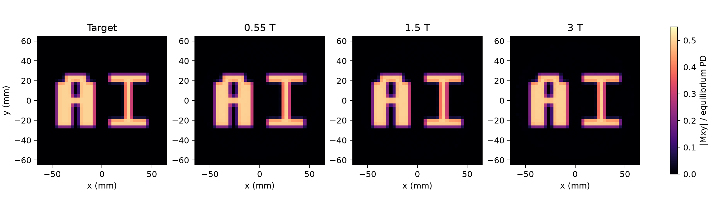
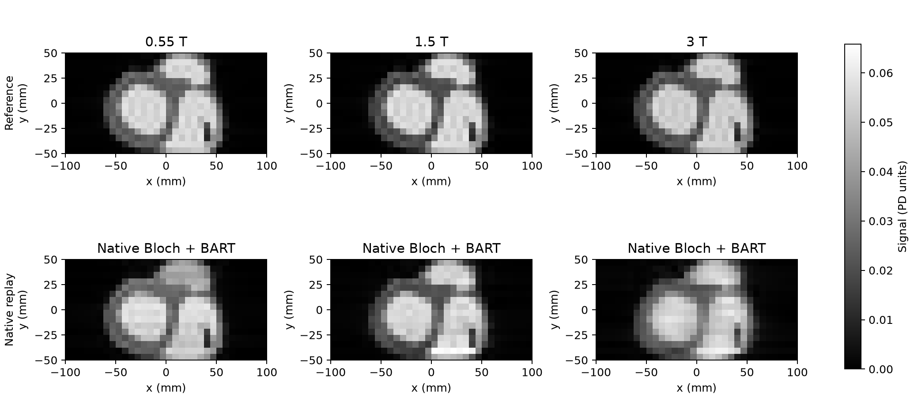

# RF task references

Both tasks are available in `rf_excitation@1` and `full@1`, across 0.55, 1.5 and
3 T scanner profiles. Each profile folder contains `sequence.seq`, `PROMPT.md`,
`task.yaml`, `case.json`, and scoring details. These are reference controls;
participants receive task requirements and public inputs rather than reference
sequence bytes or private qualification evidence.

| Task | Tier | Reference |
|---|---|---|
| `rf_excitation_2d@1` | S4: RF design | Upright AI, scored directly as transverse magnetization |
| `rfov_epi@1` | S3: spatial selection and sampling | 2D selective excitation followed by single-shot 32×16 reduced-FOV EPI |

## AI excitation

[Target](rf_excitation_2d/target.npz) ·
[0.55 T](rf_excitation_2d/low_field/) ·
[1.5 T](rf_excitation_2d/standard_1_5t/) ·
[3 T](rf_excitation_2d/high_performance/) ·
[Specification](../../docs/RF_EXCITATION_EVALUATION.md).



All panels use the same coordinates and absolute magnitude scale. CUDA
qualification passed all [18 controls](rf_excitation_2d/qualification_cuda/summary.json):
three positives and 15 negatives. Magnitude NRMSE was 0.0169–0.0190 against the
0.30 limit, and outside RMS fraction was 0.00451–0.00578 against 0.10. Independent
waveform/Bloch oracle comparisons passed. The exact frozen sequence files also
passed the promoted final judge on CPU; [CPU/CUDA response agreement](rf_excitation_2d/final_cpu_validation.json)
was within 4.2e-14. Full final CPU verdicts are included per profile.

The original CUDA controls retain their historical `uncalibrated` result,
because calibration was promoted only after all 18 outcomes were verified.
Final CPU reference verdicts are `passed` under `rf_excitation@1`.

## Reduced-FOV EPI

[0.55 T](rfov_epi/low_field/) · [1.5 T](rfov_epi/standard_1_5t/) ·
[3 T](rfov_epi/high_performance/) ·
[Specification](../../docs/RFOV_EPI_EVALUATION.md).



Reference and native Bloch+BART images share one absolute intensity scale and
the same prescribed 200×100 mm crop. Native 32×16 matrices remain available in
the central crop of the full 32×32 `images.npz` arrays.

| Scanner | Complex NRMSE | Magnitude NRMSE | Phase RMS (rad) | Selection leakage |
|---|---:|---:|---:|---:|
| 0.55 T | 0.1171 | 0.1068 | 0.0413 | 0.0717 |
| 1.5 T | 0.1361 | 0.1196 | 0.0615 | 0.0796 |
| 3 T | 0.2159 | 0.1895 | 0.1075 | 0.0466 |
| Limit | 0.45 | 0.35 | 0.35 | 0.10 |

All [24 CUDA controls](rfov_epi/qualification_cuda/summary.json) had the expected
outcome: three positives and 21 negatives. Negatives cover absent or 1D RF
selection, wrong EPI polarity, full-FOV or missing-line sampling, shifted
selection and receiver phase corruption. Per-control full verdicts, hashes,
source snapshots, numerical stages and images are retained in the qualification
folder. Declared-physics images determine acceptance; ideal-control images are
diagnostic and may fail their diagnostic checks even for an accepted reference.

Frozen qualification folders retain the exact source and prompts used for each
run. Profile-level prompts include the final explanatory disclosures of the
unchanged diagnostic water properties and sampling times.

## Use and reproduce

```bash
uv run mriseqbench list --suite rf_excitation
uv run mriseqbench describe rf_excitation_2d
uv run mriseqbench describe rfov_epi
uv run python -m tests.fixtures.qualify_rf_excitation --output tmp/ai-qualification
uv run python -m tests.fixtures.qualify_rfov_epi --output tmp/rfov-qualification
```

Select `suite: rf_excitation@1` in an experiment to use both tasks. The default
native judge requires CUDA and pinned BART; explicit CPU reference execution is
available with `MRISEQBENCH_KOMA_DEVICE=cpu`. See the main README for setup.
