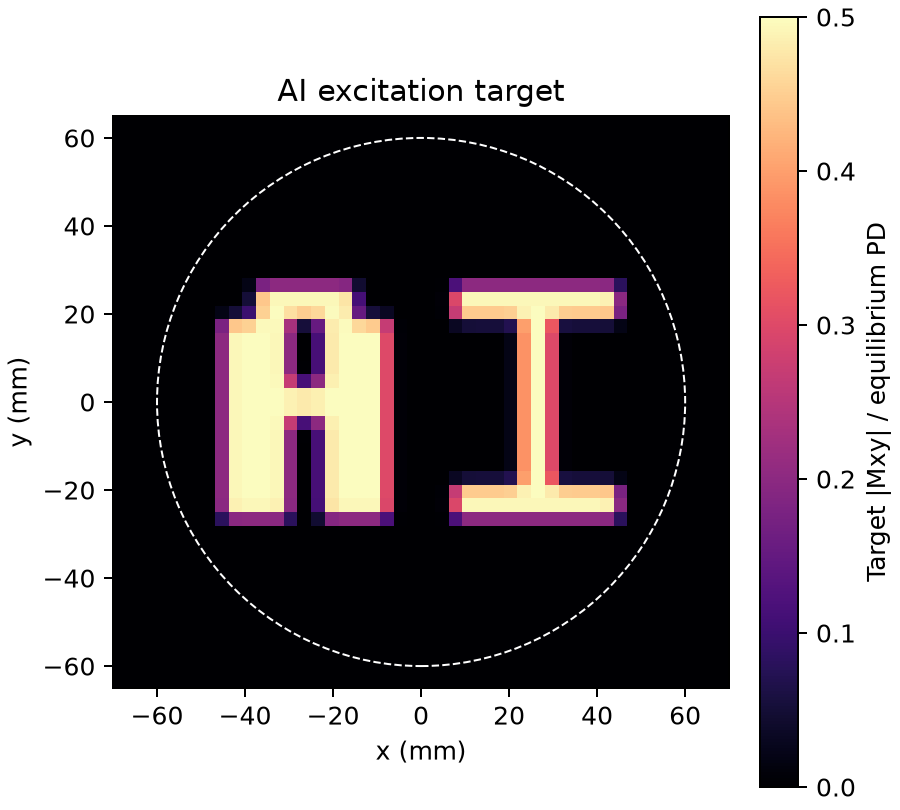

# S4 RF design: 2D RF excitation of AI

Task: [`rf_excitation_2d@1`](../benchmark/tasks/rf_excitation_2d.yaml).
Evaluator: [`rf_excitation@2`](../benchmark/evaluators/rf_excitation.yaml) (v2: quadrature SAR).
Suite: [`rf_excitation@1`](../benchmark/suites/rf_excitation.yaml), also included in `full`.

The participant designs an excitation-only Pulseq sequence that produces the
upright letters **AI**. RF and in-plane gradient trajectories are free design
choices. The complete authored sequence is limited to 40 ms and contains no ADC
or physiological triggers. Standard hardware, timing and final-submission SAR
checks apply. This is a planar spatial-excitation task at z=0.

## Independent target and public inputs

The [canonical target](../benchmark/references/rf_excitation_2d/target.npz) is a
fixed, hash-checked asset, independent of any submitted or reference pulse.
Its SHA-256 is
`8f65c3a74df053678a39eb0a245923811dc8557909500abb7f1e76695b95771f`.
The participant receives the exact same bytes as `target.npz`, listed in
`INPUTS.json`, along with the normal task, hardware, physics and phantom inputs.
Editing the participant's copy cannot change the judge's target.



The arrays `x_mm` and `y_mm` contain the 64 cell-centred coordinates of a 200 mm
FOV. `target_mxy_magnitude[ix, iy]` uses x as its first dimension and positive y
upward. `object_mask` selects the radius-60-mm uniform water disc. All 1,160 disc
spins start at equilibrium with PD=1, T1=1 s and T2=0.1 s. The registered static
B0 gradient scales with scanner field strength; there is no intrinsic fat shift.

The target magnitude is 0.5 within the letters and zero elsewhere, smoothed by a
Gaussian of sigma 1.25 mm. Its font-free definition is a 12-by-7 bitmap with
7.5 mm square cells, centred at (0,0); two blank columns separate the letters.
[`excitation_target.py`](../src/mriseqbench/evaluation/excitation_target.py) contains its analytic
definition and checks the canonical asset hash. Phase is unconstrained.

```python
import numpy as np
with np.load("target.npz") as data:
    x_mm, y_mm = data["x_mm"], data["y_mm"]
    target = data["target_mxy_magnitude"]
    object_mask = data["object_mask"]
# Plot target.T with origin="lower" to display upright AI.
```

## Native judge

KomaMRI replays the submitted finite RF and gradient waveforms, relaxation and
declared B0 in Float64. A trusted diagnostic ADC samples each spin's transverse
magnetization 1 microsecond after the complete authored sequence ends. The
derived file retains the original RF, gradient, shape and extension sections;
only a diagnostic block/ADC and duration metadata are added. The submitted file
is retained unchanged. Both hashes, sampling time, package versions, backend and
device are recorded. Participant RF labels and sequence definitions never
provide evidence of spatial selection.

No reconstruction, receive weighting, fitted gain, phase fitting, registration
or image normalization enters acceptance. The judge compares individual spin
magnitudes on the fixed disc grid against the fixed target.

| Metric | Definition | Limit |
|---|---|---:|
| `excitation_magnitude_nrmse` | Norm of magnitude error divided by target norm, over every disc spin | ≤0.30 |
| `inside_signal_fraction` | Mean response magnitude divided by mean target where target≥0.45 | ≥0.80 |
| `outside_rms_fraction` | RMS response magnitude divided by 0.5 where target≤0.005 | ≤0.10 |

Edge-transition spins still contribute to NRMSE. All checks must pass. The judge
refines RF and gradient time steps through 10, 5, 2.5, 1.25 and 0.625 microseconds
as needed. It requires estimated metric errors ≤0.002 and a resolved interval
at every acceptance boundary. Unresolved results are `incomplete` and cannot pass.
Every refinement retains its complex response and numerical diagnostics.

CUDA is the normal grader, with no automatic CPU fallback. Set
`MRISEQBENCH_KOMA_DEVICE=cpu` explicitly for CPU reference/diagnostic execution.
The synthetic global SAR model and its actual-duration duty-cycle convention
are the same as for the imaging tasks.

## References and qualification

[`rf_excitation_sequences.py`](../tests/fixtures/rf_excitation_sequences.py) independently authors a
hardware-limited inward spiral and solves a regularized small-tip RF design,
including B0 and T2. Its method, trajectory, phases and reference pulse amplitude
are examples rather than participant requirements. The judge never imports it.
[`rf_excitation_oracle.py`](../tests/fixtures/rf_excitation_oracle.py) separately integrates submitted
waveforms with midpoint Rodrigues rotations and relaxation for selected spins.
Qualification requires native/oracle absolute error ≤0.001 and oracle refinement
error ≤0.00001.

The qualification runner retains positive references and negative controls for
uniform excitation, a missing I, shifted letters, wrong amplitude and zero RF.
It freezes source bytes, resolved cases, public prompts/targets, sequences,
native responses, oracle responses, hashes and full verdicts.

CUDA qualification on an NVIDIA TITAN RTX passed all 18 controls: three positive
references and 15 negatives, spanning 0.55, 1.5 and 3 T. Positive magnitude NRMSE
was 0.0169–0.0190; outside RMS fraction was 0.00451–0.00578. Independent waveform
oracle errors were below 0.001. The [complete receipt](../benchmark/references/rf_excitation_2d/qualification_cuda/summary.json)
retains the provisional `uncalibrated` status at the time the controls ran;
`rf_excitation@1` was calibrated only after every control passed. CPU positive
controls independently reproduced the same metric range.

```bash
uv run mriseqbench list --suite rf_excitation
uv run mriseqbench describe rf_excitation_2d --hardware high_performance
uv run python -m tests.fixtures.qualify_rf_excitation --output tmp/rf-ai-qualification
```

An experiment selects the task by setting `suite: rf_excitation@1`. Reference
sequences and private qualification evidence are not copied into participant
workspaces; the target and task requirements are public.
